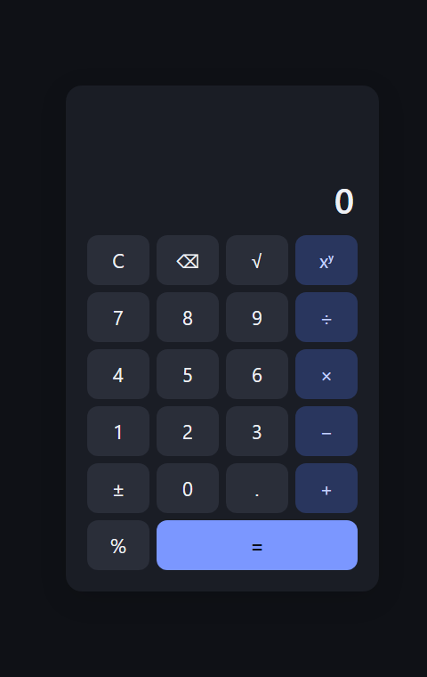
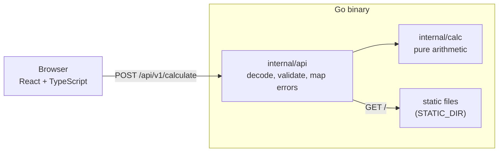

# Calculator

A calculator with a Go REST backend and a React + TypeScript frontend. The backend does all the arithmetic (add, subtract, multiply, divide, power, square root, percentage); the frontend handles input and display. One Docker image serves both the UI and the API from a single Go binary.



## Quick start

### Docker

```sh
docker build -t sezzle-calculator .
docker run --rm -p 8080:8080 sezzle-calculator
```

Open <http://localhost:8080>. (`make docker-build` and `make docker-run` do the same.)

### Local

Prerequisites (versions this was built and tested with):

- Go 1.27.0 (`backend/go.mod` declares `go 1.22.0`, needed for method-aware `ServeMux` patterns)
- Node 26.12.0 locally; the Docker build uses Node 24.22.2
- GNU Make (optional, for the targets below)

```sh
# terminal 1: API on :8080
make run-backend        # or: cd backend && go run ./cmd/server

# terminal 2: Vite dev server, proxies /api to localhost:8080
cd frontend && npm install
make run-frontend       # or: cd frontend && npm run dev
```

Backend configuration (environment variables): `PORT` (default `8080`) and `STATIC_DIR` (default empty; when set, the server also serves that directory at `/`).

## API reference

| Method | Path                | Purpose                         |
| ------ | ------------------- | ------------------------------- |
| POST   | `/api/v1/calculate` | Evaluate one operation          |
| GET    | `/healthz`          | Liveness check                  |

**Request** (`Content-Type: application/json`):

```json
{ "operation": "add", "a": 2, "b": 3 }
```

- `operation`: one of `add`, `subtract`, `multiply`, `divide`, `power`, `sqrt`, `percentage`.
- `a`, `b`: JSON numbers. Binary operations need both. `sqrt` takes only `a` and rejects `b`.
- `percentage` means "`a` percent of `b`" (`a / 100 * b`).
- Unknown fields are rejected.

**Success:** `200 {"result": <number>}`

**Error:** `{"error": {"code": "<stable_code>", "message": "<human text>"}}`

| HTTP | `code`                   | When                                                          |
| ---- | ------------------------ | ------------------------------------------------------------- |
| 400  | `invalid_json`           | Malformed body, wrong types, unknown fields, body over 1 MiB  |
| 400  | `unknown_operation`      | `operation` missing or unsupported                            |
| 400  | `missing_operand`        | `a` missing, or `b` missing for a binary operation            |
| 400  | `unexpected_operand`     | `b` supplied to `sqrt`                                        |
| 405  | `method_not_allowed`     | Non-POST on `/api/v1/calculate`                               |
| 415  | `unsupported_media_type` | `Content-Type` is not `application/json`                      |
| 422  | `division_by_zero`       | `divide` with `b == 0`                                        |
| 422  | `negative_sqrt`          | `sqrt` with `a < 0`                                           |
| 422  | `non_finite_result`      | Result is NaN or infinite (overflow, `0^-1`, `(-8)^0.5`)      |
| 500  | `internal`               | Unexpected failure; no detail is leaked                       |

400 means the request is not understood; 422 means it is well formed but has no valid answer.

### Examples

Each of these was run against the Docker image. Output is the status line and response body.

```sh
# success
curl -si -X POST localhost:8080/api/v1/calculate -H 'Content-Type: application/json' \
  -d '{"operation":"add","a":2,"b":3}'
# HTTP/1.1 200 OK
# {"result":5}

# percentage: 15% of 200
curl -si -X POST localhost:8080/api/v1/calculate -H 'Content-Type: application/json' \
  -d '{"operation":"percentage","a":15,"b":200}'
# HTTP/1.1 200 OK
# {"result":30}

# division by zero
curl -si -X POST localhost:8080/api/v1/calculate -H 'Content-Type: application/json' \
  -d '{"operation":"divide","a":1,"b":0}'
# HTTP/1.1 422 Unprocessable Entity
# {"error":{"code":"division_by_zero","message":"cannot divide by zero"}}

# square root of a negative number
curl -si -X POST localhost:8080/api/v1/calculate -H 'Content-Type: application/json' \
  -d '{"operation":"sqrt","a":-4}'
# HTTP/1.1 422 Unprocessable Entity
# {"error":{"code":"negative_sqrt","message":"cannot take the square root of a negative number"}}

# malformed JSON
curl -si -X POST localhost:8080/api/v1/calculate -H 'Content-Type: application/json' \
  -d '{"operation":'
# HTTP/1.1 400 Bad Request
# {"error":{"code":"invalid_json","message":"request body is not valid JSON"}}

# missing operand
curl -si -X POST localhost:8080/api/v1/calculate -H 'Content-Type: application/json' \
  -d '{"operation":"multiply","a":4}'
# HTTP/1.1 400 Bad Request
# {"error":{"code":"missing_operand","message":"operand \"b\" is required for multiply"}}

# unknown operation
curl -si -X POST localhost:8080/api/v1/calculate -H 'Content-Type: application/json' \
  -d '{"operation":"modulo","a":1,"b":2}'
# HTTP/1.1 400 Bad Request
# {"error":{"code":"unknown_operation","message":"unknown operation \"modulo\""}}

# wrong method
curl -si -X GET localhost:8080/api/v1/calculate
# HTTP/1.1 405 Method Not Allowed
# {"error":{"code":"method_not_allowed","message":"use POST"}}

# wrong content type
curl -si -X POST localhost:8080/api/v1/calculate -H 'Content-Type: text/plain' -d 'x'
# HTTP/1.1 415 Unsupported Media Type
# {"error":{"code":"unsupported_media_type","message":"Content-Type must be application/json"}}

# health
curl -s localhost:8080/healthz
# {"status":"ok"}
```

## Architecture



```
backend/
  cmd/server/          config from env, wiring, graceful shutdown
  internal/calc/       pure domain: operations, arity, typed errors (no HTTP, no JSON)
  internal/api/        handler, request decoding, error mapping, logging, static/SPA serving
frontend/src/
  state/               calculator reducer (pure state machine) and number formatting
  api/                 typed client with injectable fetch; server error code -> friendly message
  hooks/               useCalculator: wires reducer + client
  components/          Display, Keypad, Key (presentational)
  keyboard.ts          keydown -> calculator actions
docs/                  DESIGN.md (full rationale), COVERAGE.md
Dockerfile             3 stages: frontend build, Go build, alpine runtime
Makefile               test, cover, lint, run-*, docker-*
```

## Design decisions and trade-offs

The full reasoning is in [docs/DESIGN.md](docs/DESIGN.md). The short version:

- **The server computes.** The frontend only builds the expression and displays results. This keeps one authority for arithmetic rules (division by zero, overflow, negative roots) and makes the API useful on its own. The cost is a network round-trip per `=` and a failure mode the UI has to show (loading and error states).
- **float64, not a decimal type.** It is native to JSON, `math.Pow` and `math.Sqrt`, and needs no dependency. The limitation is real: the API returns the raw value, so `0.1 + 0.2` gives `0.30000000000000004` (checked against the image). The frontend rounds to 12 significant digits for display. Integers above 2^53 lose precision. A decimal type would still not represent `sqrt(2)` or fractional powers exactly.
- **No web framework.** Go 1.22's `net/http` handles method-aware routes, which is all this needs. The backend has no third-party dependencies.
- **One endpoint with an `operation` field** rather than one route per operation. Seven routes would mean seven handlers and doc entries with no behavioural gain. `operation` is validated against a single table.
- **Typed errors, mapped at the edge.** `calc` returns sentinel errors; `api` maps them to HTTP status and a stable `code` in one function. `calc` never sees HTTP or JSON.
- **Single-container serving.** In the image, the Go binary serves the Vite build from `STATIC_DIR=/app/static` at `/` and falls back to `index.html` for unknown non-API paths. Anything under `/api/` that doesn't match is a 404, never the app. Frontend and API share an origin, so no CORS headers are needed. In development, Vite proxies `/api` to `localhost:8080`, which keeps the browser on one origin there too.
- **Runtime image.** Alpine with a statically linked, stripped binary, running as a non-root user (uid 10001), with a `HEALTHCHECK` against `/healthz`. Final image size: 23.2 MB.

## Testing

```sh
make test    # go test ./... and vitest run (installs frontend dependencies with npm ci if needed)
make cover   # backend/coverage.out + coverage.html, frontend/coverage/ (vitest + v8)
make lint    # gofmt, go vet, tsc --noEmit, eslint, prettier --check
```

Numbers below are from `make cover` ([docs/COVERAGE.md](docs/COVERAGE.md)):

| Layer                          | Coverage                   |
| ------------------------------ | -------------------------- |
| Backend `internal/calc`        | 100.0% of statements       |
| Backend `internal/api`         | 97.2% of statements        |
| Backend `cmd/server`           | 34.0% of statements        |
| **Backend total**              | **83.0% of statements**    |
| **Frontend**                   | 98.25% statements, 97.4% branches, 97.56% functions, 99.32% lines |

The frontend has 132 tests in 6 files. The low `cmd/server` figure is `main` and `run`, which are process wiring with no direct test; `loadConfig` and `serve` are tested. The frontend report counts only files the tests load.

## Assumptions, limitations, next steps

**Assumptions**
- Single-user calculator: no auth, persistence, or rate limiting.
- Operands are finite JSON numbers. Percentage is "`a` percent of `b`".

**Known limitations**
- float64 precision, as described above.
- One operation per request; there is no expression parsing (`2+3*4` as a string).
- There are no browser end-to-end tests. The Docker image was smoke-tested with curl, and the screenshot above is the idle UI served by that image.
- Third-party origins are blocked by design (no CORS headers).
- No CI configuration.

**With more time**
- Browser end-to-end tests against the container.
- A test for `run` in `cmd/server` to lift that package's coverage.
- A CI workflow running `make lint test cover` and the Docker build.
- Decimal arithmetic if exact base-10 results mattered.
- Request-level rate limiting if the service were exposed publicly.

## AI usage

Claude Code (Anthropic's CLI agent) was used throughout: writing the design doc first, then implementing each step as a separate commit (backend domain, API, frontend state, UI, build and packaging) with tests, running the linters and tests, and building and smoke-testing the Docker image. [CLAUDE.md](CLAUDE.md) holds the project rules the agent worked under. The prompts, with their intent and outcome, are logged in [PROMPTS.md](PROMPTS.md).
